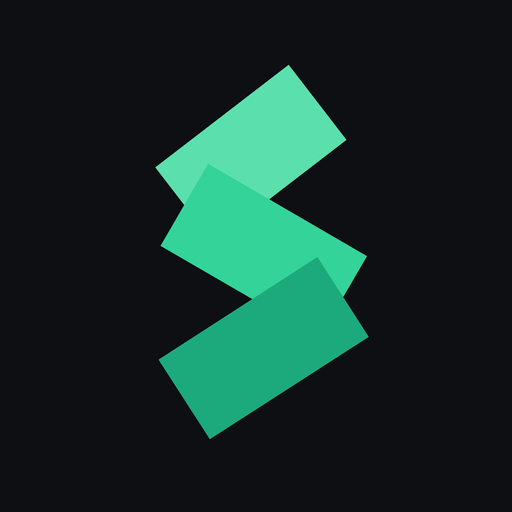

<div align="center">
  

  # Selene

  <p><i>Assistente de IA pessoal, 100% local, rodando no seu próprio hardware.</i></p>

  <p>
    
    
    
    
  </p>
</div>

---

## O que é

**Selene** é um assistente de IA pessoal, por voz e por texto, que roda **inteiramente no seu PC** — sem depender de nenhum serviço de nuvem para funcionar. Nada do que você fala ou escreve sai da sua máquina, a menos que você mesmo habilite uma ferramenta que precise da internet (busca na web, Spotify).

É um fork personalizado do [**OpenJarvis**](https://github.com/open-jarvis/OpenJarvis), o framework de IA pessoal local-first criado pelo Stanford Hazy Research / Scaling Intelligence Lab. A base (motor de inferência, agentes, memória, conectores, segurança) é do OpenJarvis; por cima dela, esse fork adiciona uma identidade própria (Selene) e um conjunto de recursos pensados pra uso do dia a dia num PC Windows:

- **Visualização em partículas** — uma "orbe" 3D (Three.js) que reage ao estado da conversa (ouvindo, pensando, falando), em vez de um chat de caixinhas de texto.
- **Modo ligação** — conversa por voz contínua, sem precisar clicar em nada a cada frase (igual uma ligação de telefone).
- **Controle do Spotify** — tocar, pausar, pular, buscar música e ajustar volume, por voz ou texto.
- **Controle do sistema** — abrir programas (Spotify, Discord, Steam, VS Code, navegadores, etc.) e ajustar o volume geral do Windows.
- **Acesso a pastas com permissão explícita** — a Selene só lê/cria/edita/apaga arquivos nas pastas que você liberar, escolhidas por um navegador de pastas dentro do próprio app (nada de acesso irrestrito ao sistema).
- **Acesso pelo celular** — dá pra abrir o mesmo assistente do celular, na mesma rede Wi-Fi, com autenticação por chave de API.
- **Voz em português** — STT (faster-whisper) e TTS (Kokoro) configurados para português do Brasil.

## Como funciona

```
┌─────────────────────┐        ┌──────────────────────────┐
│   Frontend (React)   │  HTTP  │   Backend (FastAPI)      │
│   Orbe 3D + chat      │◄──────►│   Agente orquestrador    │
│   Modo ligação        │  WS    │   Roteador de modelos    │
└─────────────────────┘        └───────────┬──────────────┘
                                            │
                      ┌─────────────────────┼─────────────────────┐
                      │                     │                     │
               ┌──────▼──────┐     ┌────────▼────────┐    ┌───────▼───────┐
               │   Ollama     │     │  Fala           │    │  Ferramentas   │
               │ (LLM local)  │     │  faster-whisper  │    │  web_search    │
               │ gemma4, etc. │     │  Kokoro TTS      │    │  spotify_control│
               └──────────────┘     └─────────────────┘    │  system_control │
                                                            │  file_read/write│
                                                            │  code_interpreter│
                                                            └────────────────┘
```

1. O **frontend** (React + Vite, PWA) mostra a orbe reativa e o chat, e grava sua voz pelo navegador.
2. O **backend** (FastAPI) recebe o texto/áudio, transcreve com **faster-whisper**, e manda pro **agente orquestrador**.
3. O agente decide se responde direto ou chama uma **ferramenta** (buscar na web, controlar o Spotify, abrir um programa, mexer em arquivo, rodar código, etc.), usando o modelo de linguagem local via **Ollama**.
4. A resposta volta como texto e, se a voz estiver ligada, como áudio sintetizado pelo **Kokoro**.
5. Um **roteador de complexidade** escolhe automaticamente um modelo mais leve ou mais robusto dependendo da pergunta (`auto_model`).

## Opções de IA (motores/modelos suportados)

A Selene não depende de um único motor de IA — o OpenJarvis por baixo suporta vários, trocáveis por config:

**Local (recomendado — privacidade total, sem custo por token):**
- [Ollama](https://ollama.com) — *padrão deste projeto* (ex: `gemma4:e4b`, `gemma4:e2b`, `deepseek-coder`, ou qualquer modelo do catálogo Ollama)
- llama.cpp, vLLM, SGLang, LM Studio, Exo, Nexa, Uzu, gemma.cpp
- MLX e Apple Foundation Models (Apple Silicon)
- AMD Lemonade

**Nuvem (opcional — só se você configurar uma chave de API):**
- OpenAI, Anthropic (Claude), Google (Gemini), DeepSeek, MiniMax
- OpenRouter e Atlas Cloud (agregadores com vários modelos)
- NVIDIA NIM, LiteLLM (proxy universal pra qualquer provedor compatível)

Por padrão, tudo roda local via Ollama — o uso de nuvem é 100% opcional e exige configuração manual.

## Pré-requisitos

- **Windows 10/11** (este fork foi testado e ajustado para Windows; o OpenJarvis original também roda em macOS/Linux)
- [**Python 3.10 a 3.13**](https://www.python.org/downloads/) + [**uv**](https://docs.astral.sh/uv/) (gerenciador de pacotes/venv)
- [**Node.js 18+**](https://nodejs.org/) e npm (para o frontend)
- [**Ollama**](https://ollama.com/download) instalado e rodando
- (Opcional) [**Rust**](https://rustup.rs/) — acelera algumas operações via uma extensão nativa; o projeto funciona sem ele

## Instalação

```powershell
# 1. Clonar o repositório
git clone https://github.com/JuhhSobrinho/IA-Selene.git
cd IA-Selene

# 2. Instalar as dependências Python num ambiente virtual isolado
uv sync --extra desktop

# 3. Baixar um modelo local pelo Ollama (escolha um que caiba na sua RAM/VRAM)
ollama pull gemma4:e4b

# 4. Instalar e buildar o frontend
cd frontend
npm install
npm run build
cd ..

# 5. Gerar uma config inicial (opcional, cria ~/.openjarvis/config.toml)
.venv\Scripts\jarvis.exe init

# 6. Subir o servidor
.venv\Scripts\jarvis.exe start
```

Depois disso, acesse **http://127.0.0.1:8000** no navegador. Pra fechar: `.venv\Scripts\jarvis.exe stop`.

### Atalho de um clique

O arquivo [`start_selene.bat`](start_selene.bat) na raiz do projeto liga o Ollama, o servidor e abre o navegador, tudo num clique só — útil pra criar um atalho na área de trabalho.

## Configuração

Tudo fica em `~/.openjarvis/config.toml` (no Windows, `C:\Users\<voce>\.openjarvis\config.toml`). Alguns pontos importantes:

```toml
[intelligence]
default_model = "gemma4:e4b"
auto_model = true                 # troca de modelo automático por complexidade da pergunta

[agent]
default_agent = "orchestrator"     # agente com uso de ferramentas (tool calling)
default_system_prompt = "..."      # personalidade/identidade do assistente

[tools]
enabled = ["web_search", "file_read", "file_write", "file_delete",
           "spotify_control", "system_control", "code_interpreter"]

[security]
profile = "personal"               # "personal" | "shared" | "server"
allowed_dirs = ["C:\\Users\\voce\\Documents\\Selene"]  # pastas que a IA pode mexer

[speech]
voice_id = "pf_dora"               # voz do Kokoro TTS (pf_dora, pm_alex, pm_santa = PT-BR)
language = "pt"
model = "medium"                   # tamanho do modelo faster-whisper (tiny/base/small/medium/large)
```

- **Permissão de pastas**: em vez de editar o TOML à mão, dá pra usar o botão **"+"** no campo de texto do chat (ou Settings → Folder Access) pra navegar e liberar uma pasta pela própria interface.
- **Spotify**: crie um app em [developer.spotify.com](https://developer.spotify.com/dashboard), adicione o redirect URI `http://127.0.0.1:8000/v1/connectors/spotify/oauth/callback`, e conecte pela aba Data Sources. Requer Spotify Premium.
- **Acesso pelo celular**: mude `[server] host = "0.0.0.0"` (em vez de `127.0.0.1`), gere uma chave com `jarvis auth create-key`, libere a porta 8000 no firewall do Windows, e acesse `http://<IP-da-sua-maquina>:8000` colando a chave em Settings → Connection → API key.

## Uso

- **Chat de texto**: digite normalmente no campo de mensagem.
- **Voz**: clique no microfone, fale, e a Selene responde em áudio (se a voz estiver habilitada).
- **Modo ligação**: botão de telefone no campo de texto — conversa contínua por voz, sem precisar clicar a cada frase.
- **Comandos de exemplo**: *"toca Legião Urbana no Spotify"*, *"abre o Discord"*, *"aumenta o volume"*, *"pesquisa X na internet"*, *"cria um arquivo resumo.txt na minha pasta"*.

## Limitações conhecidas

- **Tool calling em modelos pequenos**: modelos locais leves (ex: `gemma4:e4b`) às vezes não executam uma ferramenta corretamente — podem "narrar" que fizeram algo sem de fato chamar a ferramenta. É uma limitação do modelo, não do código; modelos maiores (7B+) tendem a ser mais confiáveis nisso.
- **Microfone pelo celular**: navegadores só liberam o microfone em conexões HTTPS ou `localhost`. Acessando por IP local (`http://192.168.x.x:8000`), o Android Chrome permite contornar isso via uma flag (`chrome://flags/#unsafely-treat-insecure-origin-as-secure`); no Safari (iOS) seria necessário configurar HTTPS.

## Créditos

Este projeto é baseado no [**OpenJarvis**](https://github.com/open-jarvis/OpenJarvis) (Stanford Hazy Research / Scaling Intelligence Lab), licenciado sob **Apache License 2.0** — veja [`LICENSE`](LICENSE). Consulte o repositório original para a documentação completa do framework base, incluindo conectores, agentes agendados, skills, aprendizado por traces e muito mais.
